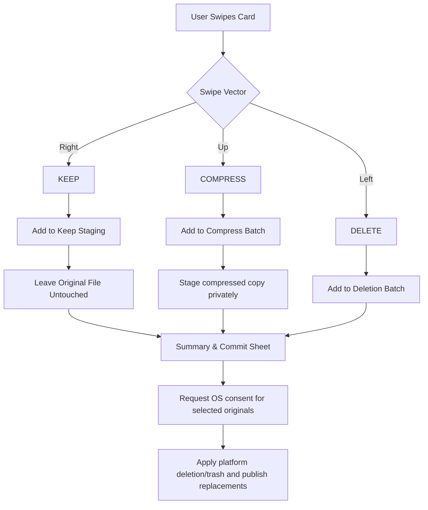

# Keepr
*A gesture-driven media triage and storage reclamation utility.*
*Swipe Right to Keep • Swipe Up to Compress • Swipe Left to Delete*

---

## 1. Executive Summary & Problem Statement

Modern smartphone users accumulate thousands of media items per year: camera bursts, screenshots, chat downloads, memes, and 4K video clips. Existing gallery apps suffer from major UX bottlenecks:
- **Binary Choice Trap**: Traditional apps force a strict **Keep** vs. **Delete** choice. Users frequently hoard photos they don't love enough to keep at full resolution (e.g., receipts, whiteboards, notes, reference pics) because they fear losing the information entirely.
- **Micro-Decision Fatigue**: Standard multi-select galleries require tapping tiny checkboxes and opening/closing fullscreen viewers repeatedly.
- **Friction in Compression**: Downscaling images usually requires transferring them to a computer or uploading them to lossy web services.

**The Solution:**
A single-card swipe deck that adds a third option: **Compress**. The intended gestures map to **Keep**, **Compress**, and **Delete**, with a review-and-confirm step before changes are applied. Throughput and storage savings depend on the device, media, and user; treat the figures in this document as product goals rather than guarantees.

---

## 2. Interaction Design & Gesture Mapping (Hinge / Dating-App Style)

### A. Tri-Directional Gesture Architecture
Unlike dating apps that only offer binary Left/Right swipes, a 3-choice system requires an ergonomic third vector:

```
                  ▲
                  │  SWIPE UP: COMPRESS (Optimize & Shrink)
                  │  [Neutral Surface Feedback]
                  │
◄─────────────────┼─────────────────►
SWIPE LEFT:       │       SWIPE RIGHT:
DELETE            │       KEEP (Preserve Original)
[Neutral]         │       [Neutral]
                  │
                  ▼
         (Quick Info / Metadata Drawer)
```

| Direction | Action | Monochrome Feedback | Dynamic Pill Badge | Sound / Haptic Cue |
| :--- | :--- | :--- | :--- | :--- |
| **Swipe Right** | **Keep** | Brighter neutral surface and outline | `KEEP FULL RES` | Light impact (optional) |
| **Swipe Left** | **Delete** | Brighter neutral surface and outline | `DELETE` | Medium impact (optional) |
| **Swipe Up** | **Compress** | Brighter neutral surface and outline | `COMPRESS` with estimated savings | Brief success tick (optional) |
| **Tap Bottom Edge** | **Inspect** | Neutral surface change | Card slides up 20% to reveal EXIF, resolution, date, and storage footprint. |

### B. Micro-Interactions & Visual Physics
1. **Dynamic Pill Overlays**: As the user drags the card off-center, an angled badge fades in and scales with the gesture distance:
   * Dragging Left: Badge says `DELETE`.
   * Dragging Right: Badge says `KEEP`.
   * Dragging Up: Badge calculates on-the-fly estimated savings: `COMPRESS (e.g., 6.8 MB ➔ 850 KB)`.
2. **Monochrome Feedback**: Action labels, icons, neutral surface changes, and gesture direction identify the action without action-specific colors.
3. **Card Stack Depth**: 3 cards visible at all times in a layered card deck with perspective scaling (Card 1: 100%, Card 2: 95% opacity/scale, Card 3: 90% opacity/scale).
4. **On-Screen Tappable Action Buttons**: Below the card stack, 3 oversized floating action buttons provide an accessibility alternative to gestures:
   * Delete Button
   * Compress Button
   * Keep Button
   * ↩️ Circular Undo Button (Crucial safety net)

---

## 3. The 3 Actions: Exact Technical Behavior



### 1. KEEP (Right Swipe)
- Leaves the file untouched in its original location (`DCIM/Camera`, `Pictures`, etc.).
- Stages a Keep decision for the current batch. Mark the file as reviewed only when the batch is committed so Undo and interrupted sessions stay consistent.

### 2. DELETE (Left Swipe)
- Files are **not** deleted on swipe. They remain staged until checkout and the platform's applicable photo-library authorization flow.
- At checkout, request authorization only for originals selected for deletion or replacement:
  - **On Android 11+ (API 30+)**: MediaStore provides system trash where user consent is requested via system dialogs (`MediaStore.createTrashRequest`), and retention is system-defined (managed by the OS/OEM; Keepr does not manage or guarantee retention duration).
  - **On Android 10 (API 29)**: MediaStore provides permanent delete upon recoverable consent (`RecoverableSecurityException`). Once approved in the system prompt, media is permanently deleted from storage.
  - **On iOS**: Assets are moved to the system "Recently Deleted" album through PhotoKit change requests (`PHAssetChangeRequest.deleteAssets`), with recovery managed by iOS and user settings.
- Accurately describe recovery according to the platform. Never make misleading promises that Keepr controls retention or that Android and iOS have identical "30 days" or "trash" semantics.

### 3. COMPRESS (Up Swipe)
This is the core differentiator of the app:
- **Intelligent Target Downscaling**: Prototype a configurable maximum dimension and WebP/JPEG quality setting, then measure output quality and size across representative photos. Treat savings as an estimate until the actual output is available; some files may not shrink enough to replace.
- **EXIF Preservation**: Preserve supported metadata (such as capture time, GPS coordinates, camera model, and orientation) when the chosen output format supports it. Validate the result and report limitations; do not promise that every gallery will interpret every tag identically.
- **Safety Swap**: The compressed image is staged privately and validated before checkout. The original is only moved to system trash (Android 11+), permanently deleted (Android 10), or moved to Recently Deleted (iOS) after obtaining the applicable user consent via system dialogs; failures must be surfaced as partial outcomes.

---

## 4. Safety Architecture & Safeguards (Preventing Disasters)

Photo managers deal with irreplaceable personal memories. The app must implement fail-safe principles:

1. **Undo Buffer**: A floating "Undo" button reverses up to the last 10 uncommitted decisions. It is unavailable after checkout changes are applied.
2. **Batch Commit Screen ("The Checkout")**:
   * Review sessions run in sets (e.g., 25, 50, or 100 photos at a time).
   * At the end of the batch, a summary screen shows:
     * *Estimated space to be recovered* before commit, followed by actual bytes reclaimed after processing
     * *Photos to Compress: 18 items*
     * *Photos to Delete: 24 items*
     * *Photos Kept: 8 items*
   * User can tap any thumbnail in the deletion list to rescue it before tapping **"Execute Changes"**.
3. **Offline-First Invariant**:
   * Core app operations (triage, compression, undo, stats, albums, grouping, search, reminders) are **100% offline with zero network dependencies**.
   * Media bytes, metadata reads, and transformations are executed entirely on-device; no media, thumbnails, or personal metrics are ever transmitted over the network.
   * Cloud sync (e.g., Google Drive backup/sync) is strictly opt-in, disabled by default, and fully decoupled from core app workflows.
   * If cloud sync is disabled or disconnected, the app makes zero network calls. Cloud availability, login status, or sync failures never interrupt or block offline triage or reclamation.
   * If an opt-in cloud provider is compiled into the app, its network client remains completely inert until the user explicitly connects their account in Settings.
   * Offline-first behavior minimizes external exposure and ensures predictable privacy, though it is not by itself a substitute for device-level security.

---

## 5. Session Modes & Smart Triage Queues

Instead of forcing users to sort 10,000 photos in a single endless queue, the app organizes media into digestible categories:

| Mode | Target Scope | User Benefit |
| :--- | :--- | :--- |
| **"Old Screenshots"** | Best-effort detection of screenshots older than a configurable age (default 30 days). | A focused queue for reviewing older captures. |
| **"Heavy Hitters"** | Queries files sorted by size (> 15 MB). | Reclaims maximum storage in minimal swipes. |
| **"Messaging Media"** | Best-effort filtering using media metadata exposed by the platform and library authorization. | Helps find downloaded memes and media clutter where identifiable. |
| **"On This Day"** | Photos taken on today's date in previous years. | Nostalgic review mode; users love reviewing memories while organizing. |
| **"Month by Month"** | e.g. October 2023, September 2023 | Predictable, bite-sized progress tracking. |

## 6. Additional Feature Ideas

All features in this table are designed to work offline using on-device media, metadata, and storage. Cloud backup/sync is an optional exception: it requires network access and must never be required for core app use.

“Album” can mean either a Keepr-managed local collection or an album in the device's photo library. These are different features. iOS PhotoKit limited-library access does not support fetching or creating user albums; Keepr should offer its own local collections for assets the user has selected. Android device albums also depend on MediaStore and storage-provider behavior. The app must communicate which kind of album it is creating.

| Feature | Offline behavior | Optional cloud use |
| :--- | :--- | :--- |
| **Album creation** | Create albums and organize selected local-library items. | Sync album organization when the user enables a provider. |
| **Smart albums** | Group by date, type, size, or locally available metadata. | None required. |
| **Custom review albums** | Start a triage session from a chosen on-device album. | None required. |
| **Duplicate finder** | Find exact and likely similar items using on-device comparison. | None required. |
| **Burst and sequence review** | Group nearby shots and help choose which to keep. | None required. |
| **Large video review** | Find large or long videos from local library metadata. | None required. |
| **Favorites and protected items** | Exclude favorites and user-protected items from destructive actions. | None required. |
| **Review reminders** | Schedule local reminders and recurring sessions. | None required. |
| **Progress and storage insights** | Keep session history locally and show measured storage changes. | Optionally back up or sync history. |
| **Undo and recovery guide** | Undo uncommitted decisions and explain device recovery options. | None required. |
| **Private review mode** | Hide sensitive previews in app switcher snapshots and notifications. | None required. |
| **Share or export selection** | Prepare a selection locally; the user chooses the destination. | Cloud destinations work when selected and available. |
| **Search and filters** | Search local media and metadata on-device. | None required. |
| **Storage forecast** | Estimate savings from local media and report measured results after processing. | None required. |
| **Album-aware safeguards** | Show album context and optionally protect selected albums from destructive actions. | None required. |
| **Cloud backup and sync** | App remains fully usable when disabled or offline. | Optional opt-in backup/sync through Google Drive or a similar provider. |

---

## 7. Technical Stack

* **Application UI**: React Native with TypeScript for shared iOS and Android screens, navigation, accessibility, and triage state.
* **Native platform integration**: Custom Swift/Objective-C and Kotlin/Java modules behind typed React Native interfaces for photo-library access, system consent, image/video processing, and background work (`MediaStoreAdapter`, `PhotoKitAdapter`, `AndroidCompressor`, `IOSCompressor`, WorkManager, BackgroundTasks).
* **Development & Build Architecture**: Custom Development Build workflow (using local native toolchains via `npx expo run:android` / `npx expo run:ios` / native Gradle, or cloud compilation via EAS Build with a `development` profile). **Expo Go is NOT supported** because of Keepr's custom native modules.
* **Gestures and animation**: React Native Gesture Handler and Reanimated, with accessible labeled action buttons as alternatives to swipes.
* **Media and persistence**: A local database and durable app-private staging, selected to work on both platforms. Persist decisions and job state locally; media bytes stay on device. Cloud-backed iOS assets may not be available offline; Keepr must not download them silently.
* **Compression**: Use platform encoders and codecs behind one shared interface. Capability-check formats at runtime; savings remain estimates until output is measured.
* **Networking & Privacy**: Core features are strictly offline-first. Core operations (triage, compression, undo, stats, albums) operate 100% offline with zero network dependencies. No background analytics, telemetry, or third-party tracking exist. Zero automatic cloud syncing; optional cloud backup/sync is strictly opt-in and disabled by default. Network access is requested only if the user explicitly connects a cloud provider in Settings. The OS may independently synchronize the user's Photos/media library; that is managed by the operating system and is distinct from Keepr.
* **Repository Hygiene**: No secrets, credentials, API keys, or private signing keys are stored in the repository.

The shared React Native layer owns product behavior and presentation. Native modules own OS media-library operations because Android MediaStore and iOS PhotoKit have fundamentally different authorization, commit, and recovery semantics:
- **On Android 11+ (API 30+)**: MediaStore provides system trash where user consent is requested via system dialogs (`MediaStore.createTrashRequest`), and retention is system-defined (managed by the OS/OEM; Keepr does not manage or guarantee retention duration).
- **On Android 10 (API 29)**: MediaStore provides permanent delete upon recoverable consent (`RecoverableSecurityException`) without system trash.
- **On iOS**: Assets are moved to the system "Recently Deleted" album through PhotoKit change requests (`PHAssetChangeRequest.deleteAssets`), with recovery managed by iOS and user settings.
Android system trash consent and iOS PhotoKit change requests must never be presented as identical flows, and Keepr never promises a fixed retention window.

---

## 8. Build, Run & Verification Guide

> [!WARNING]
> ### Expo Go is Unsupported
> **Keepr CANNOT run inside the standard Expo Go app.**
> Keepr relies heavily on custom native modules and platform-level APIs:
> - **Android**: Custom `MediaStoreAdapter` (handling scoped storage queries, API 29–35+ permissions matrix, and `MediaStore.createTrashRequest` / `RecoverableSecurityException`), `AndroidCompressor` (hardware-accelerated downscaling and `androidx.exifinterface` preservation), and Android Jetpack WorkManager foreground/background workers.
> - **iOS**: Custom `PhotoKitAdapter` (handling PhotoKit change requests, limited-library authorization, and `PHPhotoLibraryChangeObserver`), `IOSCompressor` (`ImageIO`, `AVAssetExportSession`), and iOS BackgroundTasks framework.
>
> Expo Go only contains a pre-compiled set of standard Expo modules and does not bundle Keepr's custom native code. Attempting to run Keepr inside Expo Go will fail at runtime with missing native module errors.
>
> **You MUST build a Custom Development Build** (via `npx expo run:android` / `npx expo run:ios` or EAS Build with a `development` profile) to run and test Keepr.

---

### Prerequisites

| Tool | Android Development | iOS Development (macOS only) | Optional Cloud Build |
| :--- | :--- | :--- | :--- |
| **Node.js** | v22+ (tested on Node v22 / v26) | v22+ (tested on Node v22 / v26) | v22+ |
| **Package Manager** | `npm` | `npm` | `npm` |
| **JDK** | OpenJDK 21 | N/A | Managed by EAS |
| **Native SDK / IDE** | Android SDK Platform 35, Build Tools 35.0.0 / 36.0.0 | Xcode 15+ (Command Line Tools) | Managed by EAS |
| **CocoaPods** | N/A | CocoaPods 1.14+ (`pod install`) | Managed by EAS |
| **CLI Tools** | Android Emulator / ADB | iOS Simulator / `xcrun` | `eas-cli` (`npm i -g eas-cli`) |

> [!NOTE]
> Native iOS compilation requires macOS and Xcode. Linux host environments cannot compile native iOS targets or run the iOS Simulator, although TypeScript checks, domain logic, and Jest tests run cross-platform on all OS environments.

---

### Setup Instructions

1. **Clone and install dependencies**:
   ```bash
   git clone https://github.com/keepr-app/keepr.git
   cd keepr
   npm install
   ```

2. **Configure Android SDK**:
   Create or update `android/local.properties` with your Android SDK location:
   ```properties
   sdk.dir=/path/to/your/android/sdk
   ```
   *(Or ensure the `ANDROID_HOME` or `ANDROID_SDK_ROOT` environment variable is exported).*

3. **Install iOS Pods (macOS only)**:
   ```bash
   cd ios && pod install && cd ..
   ```

---

### Local Development Workflow: Custom Development Builds

Running Keepr locally requires compiling the native modules into a development build and connecting it to the Metro development server.

#### Step 1: Start the Metro Bundler
Start the development bundler in your project root:
```bash
npx expo start
# Or using npm:
npm start
```

#### Step 2: Build and Run on Android
Launch the custom development build on a running Android emulator or connected device (with USB debugging enabled):
```bash
# Using Expo CLI to compile and launch the debug build:
npx expo run:android

# Or using the React Native CLI / npm script:
npm run android
```

Alternatively, compile the debug APK directly with Gradle:
```bash
cd android && ./gradlew assembleDebug && cd ..
```
The compiled APK will be located at:
`android/app/build/outputs/apk/debug/app-debug.apk`

To manually install and launch on your connected device:
```bash
adb install -r android/app/build/outputs/apk/debug/app-debug.apk
```

#### Step 3: Build and Run on iOS (macOS only)
Launch the custom development build on an iOS Simulator or connected iOS device:
```bash
# Using Expo CLI:
npx expo run:ios

# Or using npm:
npm run ios
```

---

### Optional: EAS Cloud Build Workflow

Contributors who do not have local Android SDK or macOS/Xcode development environments configured can generate custom development builds using **EAS Build** (Expo Application Services).

1. **Install EAS CLI and Log In**:
   ```bash
   npm install -g eas-cli
   npx eas login
   ```

2. **Configure Build Profile**:
   Ensure `eas.json` includes a `development` profile that compiles custom native modules into a development client:
   ```json
   {
     "build": {
       "development": {
         "developmentClient": true,
         "distribution": "internal"
       },
       "preview": {
         "distribution": "internal"
       },
       "production": {}
     }
   }
   ```

3. **Trigger EAS Cloud Builds**:
   - **Android Development Build**:
     ```bash
     eas build --profile development --platform android
     ```
   - **iOS Development Build**:
     ```bash
     eas build --profile development --platform ios
     ```
   - **All Platforms**:
     ```bash
     eas build --profile development --platform all
     ```

4. **Signing & Credential Requirements for EAS**:
   - **Android**:
     - EAS can automatically generate and securely manage a development keystore on Expo's servers.
     - Alternatively, configure your own custom upload keystore (`.keystore` / `.jks`, alias, and password) via `eas credentials`.
     - Output is an installable `.apk` file that can be downloaded directly to any Android device or emulator.
   - **iOS**:
     - Requires an active **Apple Developer Program** account ($99/year).
     - EAS will interactively prompt for your Apple ID, Apple Team ID, and create or import an iOS Development Certificate and Provisioning Profile.
     - Devices must have their Unique Device Identifiers (UDIDs) registered in your Apple Developer account for Ad Hoc internal distribution.
     - Output is an installable internal build or can be submitted to TestFlight.

> [!IMPORTANT]
> EAS Development Builds include all custom native modules (`android/` and `ios/`). They behave identically to local custom development builds, allowing full testing of MediaStore, PhotoKit, and compression features.

---

### Running Tests & Verification

Keepr maintains a multi-layer verification strategy across TypeScript, native JVM, and platform builds:

1. **TypeScript Typecheck & Full Jest Suite (20 suites, 129 tests)**:
   ```bash
   npx tsc --noEmit && npm test
   ```
   *Verifies deck gestures, triage rules, undo eviction, storage repositories, and domain coordinators without native runtime dependencies.*

2. **Native Android JVM Unit Tests (24 tests)**:
   ```bash
   cd android && ./gradlew test && cd ..
   ```
   *Verifies `MediaStoreAdapter` scoped storage queries, permissions mapping, `AndroidCompressor` aspect ratio / downscaling math, and ExifInterface metadata handling.*

3. **Android Debug APK Compilation**:
   ```bash
   cd android && ./gradlew assembleDebug && cd ..
   ```
   *Validates that all native C++, Kotlin, and Gradle dependencies compile cleanly into `app-debug.apk`.*

4. **Linter & Code Formatting**:
   ```bash
   npm run lint
   ```

---

### Offline-First, Zero Telemetry & Privacy Requirements

Keepr is built from the ground up to guarantee user data privacy and local storage autonomy:

1. **100% Offline-First Architecture**:
   - Core app operations (triage queues, card deck gestures, compression, undo buffer, local statistics, Keepr collections, search, reminders, and checkout commit) execute **strictly on-device**.
   - Zero network connectivity is required for normal operation. The app functions fully in Airplane Mode.
   - Media files, metadata, thumbnails, and personal triage decisions are never transmitted off-device.
2. **Zero Analytics & Zero Telemetry**:
   - There are **no tracking SDKs, no analytics services, and no background telemetry** in Keepr.
   - No crash reports or metrics are dispatched over the network.
3. **Zero Automatic Cloud Syncing**:
   - Cloud backup/sync (e.g., Google Drive) is strictly opt-in, disabled by default, and fully decoupled from core app workflows.
   - If cloud sync is disabled, the network client remains completely inert and makes zero network calls.
   - OS-level photo synchronization (e.g., Apple iCloud Photos or Google Photos) is managed solely by the host operating system, distinct from Keepr.
4. **Repository Credential & Secret Hygiene**:
   - **Strictly NO secrets, API keys, credentials, private signing keys, or tokens are committed to this repository.**
   - All environment files (`.env*`), SDK property files (`android/local.properties`), keystores (`*.keystore`, `*.jks`), and provisioning files must remain git-ignored at all times.

---

## 9. Verification Status & Roadmap

See [`docs/TASK_ROADMAP.md`](docs/TASK_ROADMAP.md) for the active engineering backlog and granular acceptance criteria.

### Verification Status in Current Environment
- **Scaffold & Domain Layer**: Verified (Phase 1 complete).
- **TypeScript & Jest Test Suite**: 20 test suites, 129 tests passing (`npx tsc --noEmit && npm test`).
- **Android JVM Unit Tests**: 24 tests passing across MediaStore and Compressor adapters (`cd android && ./gradlew test`).
- **Android Debug APK Build**: Clean compilation succeeded (`cd android && ./gradlew assembleDebug` generated `app-debug.apk`).
- **Tasks Requiring Physical Device / Live Credential Verification**:
  - Task 2.1 (Android MediaStore): Physical hardware verification across API 29–35+ for camera/OEM quirks, external volumes, and hardware airplane mode.
  - Task 2.2 (iOS PhotoKit): Physical iOS device or macOS simulator for `PHPhotoLibraryChangeObserver`, iCloud-only assets, and limited-library picker (Linux host environment cannot run Xcode/iOS Simulator).
  - Task 3.2 (Image Compression): Physical device validation of hardware codecs, RAW/DNG/HEIC camera formats, and thermal behavior under load.
  - Task 3.3 (Video Compression): Physical device video playback validation across Android & iOS devices (codecs, audio sync, frame-rate preservation).
  - Task 5.2 (Commit Adapters): Physical device testing of Android 11+ system trash dialog, Android 10 RecoverableSecurityException dialog, and iOS Photos change authorization dialog.
  - Task 5.3 (Durable Processing): Physical device testing for WorkManager under OS battery optimization / background quotas and iOS Background Tasks scheduling limits.
  - Task 6.4 (On-Device Albums): Physical device tests across Android OEM gallery implementations and iOS Photos album permission boundaries.
  - Task 6.9 (Cloud Backup/Sync): Real Google Cloud OAuth credentials and live network verification.

---

## 10. Agentic Development Documentation

Comprehensive specifications and operational guidelines for autonomous coding agents and human engineers are located in the [`docs/`](./docs) directory:

- 🏗️ **[System Architecture](docs/ARCHITECTURE.md)**: React Native shared layer, native platform modules, data flow, and concurrency boundaries.
- 🎨 **[UI Guidelines](docs/UI_GUIDELINES.md)**: Monochrome dark-first palette, action feedback, accessibility, components, and motion.
- 📐 **[Technical Specification](docs/TECHNICAL_SPEC.md)**: Platform media access, on-device compression, metadata preservation, gesture physics, and safe commit behavior.
- 🤖 **[Agent Guidelines](docs/AGENT_GUIDELINES.md)**: Operational rules for contributors, media safety, React Native and native-module boundaries, and verification.
- 🗺️ **[Task Roadmap & Backlog](docs/TASK_ROADMAP.md)**: Granular, phased execution backlog with acceptance criteria (Definition of Done) ready for agent assignment.

