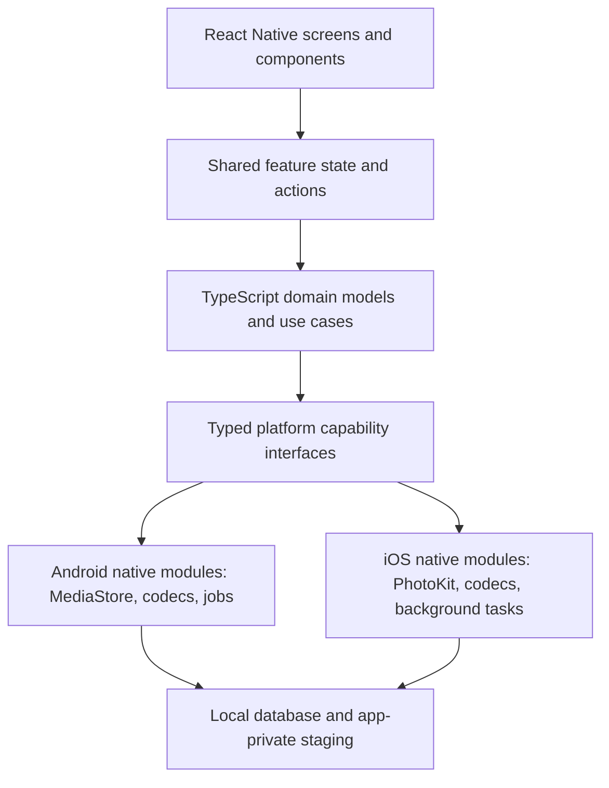

# Architecture & System Design — Keepr

This document defines the architecture of Keepr's React Native application for iOS and Android. Shared product behavior belongs in TypeScript; OS media access and processing belong behind narrow native interfaces.

## 1. Principles

1. **Offline-first & Privacy-Centric**: Core app operations (triage, compression, undo, stats, albums) are 100% offline with zero network dependencies. All media bytes, metadata, decisions, search, and session history work entirely on-device without a connection. There is zero telemetry, zero analytics, and zero automatic cloud syncing. Optional cloud backup/sync (e.g., Google Drive) is strictly opt-in and disabled by default. Absolutely no secrets, API keys, or private credentials are stored in the repository.
2. **Platform-aware safety**: Never overwrite originals. Stage and validate outputs, obtain the applicable OS authorization, and report partial outcomes. Android and iOS have fundamentally distinct consent and recovery models:
   - On Android 11+: MediaStore provides system trash where user consent is requested via system dialogs, and retention is system-defined (Keepr does not manage or guarantee retention duration).
   - On Android 10: Permanent delete upon recoverable consent.
   - On iOS: Assets are moved to the system "Recently Deleted" album through PhotoKit change requests, with recovery managed by iOS and user settings.
   - Never promise that Keepr controls retention or that Android and iOS have identical "30 days" or "trash" semantics.
3. **Shared behavior, native capabilities**: Queues, triage decisions, undo, summaries, and presentation are shared. Media-library queries, permissions, trash/delete requests, codecs, and background execution are platform implementations.
4. **Responsive UI**: Expensive media queries, metadata reads, and transforms must not block the React Native UI thread. Use native/background execution when work is long-running.
5. **Typed boundaries**: Expose stable, typed interfaces and platform-neutral identifiers/results to TypeScript. Do not leak Android `Uri` or iOS `PHAsset` objects into shared state.
6. **Custom Development Build (Expo Go Unsupported)**: Keepr relies on custom native modules on both Android (`MediaStoreAdapter`, `AndroidCompressor`, WorkManager) and iOS (`PhotoKitAdapter`, `IOSCompressor`, BackgroundTasks). Consequently, **Expo Go cannot run Keepr**. Developers and automated pipelines must run Keepr using a Custom Development Build (`npx expo run:android` / `npx expo run:ios`) or EAS Build with a `development` profile.

## 2. Layered Design



### Responsibilities

* **`src/features`**: deck, queues, checkout, inspect, and statistics screens; React components render state and dispatch actions.
* **`src/domain`**: platform-neutral media models, triage rules, use cases, validation, and result types.
* **`src/platform`**: TypeScript interfaces/adapters for media library, permissions, compression, durable jobs, and persistence.
* **`src/data`**: local database, repositories, session recovery, and staging metadata.
* **Optional cloud adapter**: isolated provider integration for user-enabled backup/sync. Core repositories and features must not depend on it; sync metadata must remain separate from media mutation and triage commits. Use provider-approved authorization, keep tokens in platform secure storage, define encryption and conflict behavior before implementation, support disconnect/revocation, and never sync source media by default.
* **`ios/` and `android/`**: native implementations of platform capability interfaces (`MediaStoreAdapter`, `PhotoKitAdapter`, `AndroidCompressor`, `IOSCompressor`, WorkManager, BackgroundTasks). Because these custom native modules are not bundled in standard Expo Go, **Expo Go is unsupported**; runtime execution requires a Custom Development Build.

## 3. State and Data Flow

Use unidirectional data flow. A feature owns immutable screen state and receives explicit actions such as `Swipe`, `Undo`, `Inspect`, and `RequestCheckout`. Use the project's chosen state-management library consistently; do not couple domain logic to React components or a specific state library.

Example platform-neutral model:

```ts
type TriageDecision = 'KEEP' | 'COMPRESS' | 'DELETE';

interface MediaItem {
  id: string; // opaque stable identifier supplied by the platform adapter
  mediaType: 'IMAGE' | 'VIDEO';
  assetRef: string; // opaque platform handle/reference; never parse it in shared domain logic
  sizeBytes: number;
  capturedAt?: number;
}
```

Persist uncommitted decisions so an interrupted session can be resumed or safely discarded. Undo applies only before commit. Track completion per item because system consent, media mutation, and replacement publication are not atomic.

## 4. Platform Capability Contracts

Provide typed async contracts for:

* Requesting and refreshing library authorization, including limited/selected access.
* Querying and paging media with best-effort filters.
* Reading metadata and producing validated compressed outputs in durable private staging.
* Committing selected changes through OS-supported APIs and returning per-item outcomes.
* Resuming/cancelling long-running work and cleaning up app-owned temporary files.

Android adapters use MediaStore and its applicable consent APIs. iOS adapters use PhotoKit authorization and change requests. Document platform differences in UI copy and results:
- **On Android 11+ (API 30+)**: MediaStore provides system trash where user consent is requested via system dialogs (`MediaStore.createTrashRequest`), and retention is system-defined (managed by the OS/OEM; Keepr does not manage or guarantee retention duration).
- **On Android 10 (API 29)**: MediaStore provides permanent delete upon recoverable consent (`RecoverableSecurityException`) without system trash.
- **On iOS**: Assets are moved to the system "Recently Deleted" album through PhotoKit change requests (`PHAssetChangeRequest.deleteAssets`), with recovery managed by iOS and user settings.
Never call an iOS deletion a trash operation or imply Android trash retention on iOS, and never promise that Keepr controls retention or that Android and iOS have identical recovery semantics.

### Platform behavior contract

| Capability | Android | iOS | Shared behavior |
|---|---|---|---|
| Library authorization | Versioned image/video runtime permissions; selected visual access on Android 14+ when targeted accordingly. | PhotoKit read/write authorization can be full, limited, denied, or restricted. | Re-check on foreground; represent visible subset and authorization status separately. |
| One-off selection | Android Photo Picker can grant individual selected media without broad library permission. | Photos picker can provide selected assets without broad PhotoKit access. | Use for targeted import; broad triage requires library enumeration permissions. |
| Library inventory | MediaStore queries against shared device media. | PhotoKit fetches against Photos library assets/collections. | Paginate; opaque IDs; handle stale or revoked references. |
| Native albums | Directory/MediaStore organization; use provider APIs and `RELATIVE_PATH` for created media. | PhotoKit user albums and collections. | Keepr collections are local and cross-platform; never promise native-album parity. |
| Limited access | Selected media access/reselection on supported OS versions. | Limited Photos access; user albums cannot be fetched or created. | Show scope limitations; offer Keepr-local collection behavior when possible. |
| Delete | Android 11+: MediaStore system trash dialog (system-defined retention). Android 10: Per-item recoverable consent resulting in permanent deletion. | PhotoKit change request moving assets to system "Recently Deleted" album; recovery governed by iOS and user settings. | Stage until checkout; report outcome per item; explain platform recovery semantics without promising a Keepr-controlled retention window. |
| Offline bytes | Process local MediaStore bytes; do not treat cloud-backed picker results as local. | PhotoKit resource may need iCloud download. Disallow network by default and surface unavailable-offline state. | No silent downloads; user opt-in is required for online retrieval. |
| Long processing | WorkManager/foreground worker as allowed by OS version and quotas. | Supported Background Tasks/continued processing where available; scheduling and runtime are OS-controlled. | Checkpoint, cancellably process, and never promise indefinite background completion. |

Map platform results to shared statuses such as `permissionRequired`, `limitedAccess`, `unavailableOffline`, `needsUserConsent`, `processing`, `partialSuccess`, and `complete`. Preserve the native error code and operation ID for diagnostics, but do not log media names, paths, thumbnails, or GPS data.

### Album and protection boundaries

Treat a Keepr-managed local collection as an app database feature that stores asset references; treat an Android folder-backed album or iOS Photos album as a system-library feature. In iOS limited access, hide or disable native album browsing/creation while keeping local Keepr collections available for selected assets. On both platforms, “remove from album” and “delete from library” are distinct user actions. A Keepr protection flag is authoritative across platforms; native favorite markers are optional hints and cannot replace it.

## 5. Persistence and Background Work

Choose a local database supported on both platforms for reviewed media, Keepr collections, session history, preferences, search indexes, reminders, and pending jobs. Store media outputs in durable app-private storage until commit succeeds or the user discards the operation. Cache is only for disposable previews. Long transforms must report progress, support cancellation where possible, and recover after process termination within platform limits. Core app operations (triage, compression, undo, stats, albums) are 100% offline with zero network dependencies. Optional cloud backup/sync must be strictly opt-in, disabled by default, and must not block or replace local operation. iOS assets backed only by iCloud are unavailable for offline processing until the user explicitly allows retrieval; OS-managed Photos synchronization is distinct from Keepr's optional provider sync.

## 6. Concurrency and Failure Handling

Native modules must perform disk IO, decoding, database work, and encoding away from the UI thread. Return typed errors and per-item commit outcomes. Never swallow errors or claim rollback when the OS has already applied some changes. Preserve staged output when retry is safe, and explain partial completion to the user.

## 7. Verification Strategy & Build Architecture

Keepr implements a multi-tier verification and build strategy spanning shared domain logic, native modules, and end-to-end device runs.

### Custom Development Build Requirement (Expo Go Unsupported)
Because Keepr relies on custom native modules (`MediaStoreAdapter`, `PhotoKitAdapter`, `AndroidCompressor`, `IOSCompressor`, Android WorkManager, and iOS BackgroundTasks), **Expo Go is fundamentally unsupported**. Attempting to load the project in Expo Go will throw runtime module resolution errors. Developers and CI pipelines must use a Custom Development Build.

### Build & Run Workflows

1. **Local Android Development Build**:
   - **Prerequisites**: Node.js v22+, OpenJDK 21, Android SDK Platform 35, Build Tools 35.0.0 / 36.0.0, and an Android emulator or device with USB debugging enabled.
   - **Start Bundler**: `npx expo start` (or `npm start`).
   - **Build & Run**: `npx expo run:android` (or `npm run android`).
   - **Direct Gradle Debug Build**: `cd android && ./gradlew assembleDebug && cd ..` (outputs to `android/app/build/outputs/apk/debug/app-debug.apk`).
   - **Sideload**: `adb install -r android/app/build/outputs/apk/debug/app-debug.apk`.

2. **Local iOS Development Build (macOS host only)**:
   - **Prerequisites**: macOS, Xcode 15+ (Command Line Tools), CocoaPods (`gem install cocoapods`), and an iOS Simulator or registered device.
   - **Pod Installation**: `cd ios && pod install && cd ..`.
   - **Build & Run**: `npx expo run:ios` (or `npm run ios`).
   - *Note*: Linux build environments cannot compile native iOS binaries or run the iOS Simulator, though all shared TypeScript and domain tests run cross-platform on Linux.

3. **Optional EAS Cloud Build Workflow**:
   - **CLI & Account**: Install `eas-cli` (`npm install -g eas-cli`) and authenticate with an Expo account (`npx eas login`).
   - **Build Profile**: Configure `eas.json` with a `"development"` profile (`"developmentClient": true`).
   - **Commands**:
     - Android: `eas build --profile development --platform android`
     - iOS: `eas build --profile development --platform ios`
     - All: `eas build --profile development --platform all`
   - **Signing & Credentials**:
     - *Android*: Auto-generated EAS development keystore or custom upload keystore (`.keystore`/`.jks`). Outputs installable `.apk`.
     - *iOS*: Requires active Apple Developer Program account. EAS manages Apple Team ID, Certificates, and Provisioning Profiles with registered device UDIDs for internal Ad Hoc distribution.

### Verification Matrix
1. **Domain & Unit Layer**: `npx tsc --noEmit && npm test` verifies platform-neutral models, bounded 10-item undo eviction, triage state transitions, and repository interactions.
2. **Native JVM Layer**: `cd android && ./gradlew test` executes 24 unit tests against `MediaStoreAdapter` and `AndroidCompressor`.
3. **Physical Device Validation**: Physical devices are required to validate OS-level user consent dialogs (`MediaStore.createTrashRequest`, `RecoverableSecurityException`, `PHAssetChangeRequest`), camera format decodability (RAW/DNG, HEIC), and background execution limits under battery optimization. Mocks alone cannot establish OS compliance.
4. **Privacy & Hygiene Verification**: Automated and manual checks ensure 100% offline-first execution, zero telemetry, zero analytics, zero automatic cloud sync, and zero credentials or secrets committed to git.
